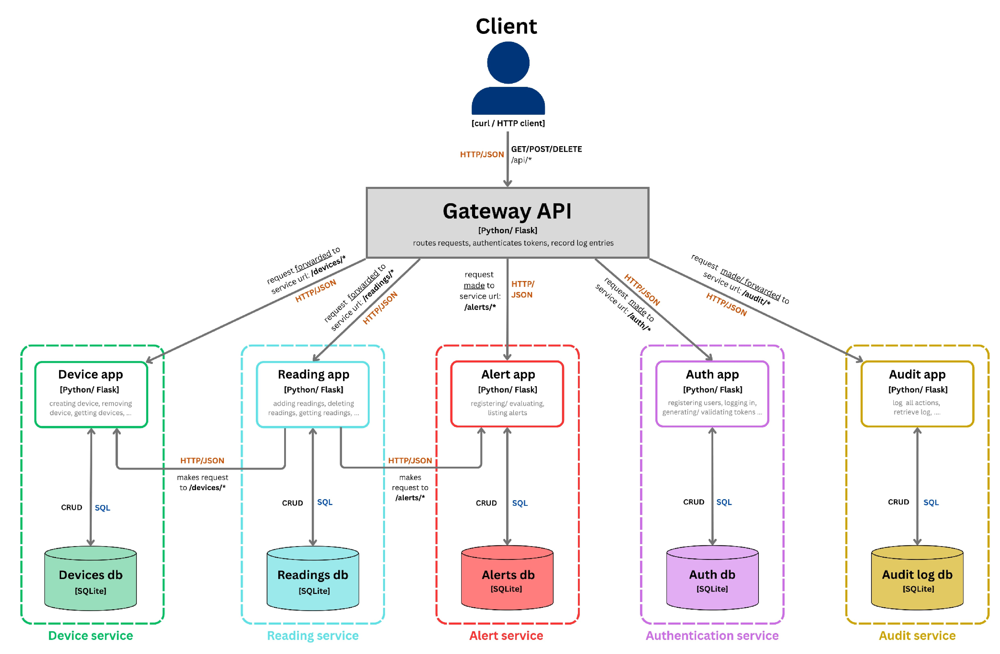

# Module 2 – Microservices: building-monitoring back end

Four independently runnable services, each with **its own SQLite database**,
behind an API gateway. Services talk to each other **only over HTTP**.

```
client ──► gateway (5000) ──► device_service  (5001)  devices.db
                          ├─► reading_service (5002)  readings.db ──► device_service (exists?)
                          │                                       └─► alert_service (evaluate)
                          └─► alert_service   (5003)  alerts.db
```

| Route (gateway)                 | Forwarded to                     |
|---------------------------------|----------------------------------|
| `GET/POST /api/devices`         | device_service `/devices`        |
| `GET /api/devices/<id>`         | device_service `/devices/<id>`   |
| `GET/POST /api/readings`        | reading_service `/readings`      |
| `GET /api/alerts`               | alert_service `/alerts`          |
| `GET /health`                   | pings every service              |

## Container diagram of the microservices


## Run

```bash
pip install -r requirements.txt
python run_all.py --reset          # starts every service in services.txt
curl -X POST localhost:5000/api/devices -H 'Content-Type: application/json' \
     -d '{"name":"temp-1","room":"A101","type":"temperature"}'
curl -X POST localhost:5000/api/readings -H 'Content-Type: application/json' \
     -d '{"device_id":1,"value":29.5}'
curl localhost:5000/api/alerts
```

## Test

```bash
python -m pytest -q             # starts the services on ports 5100-5105 automatically
```
